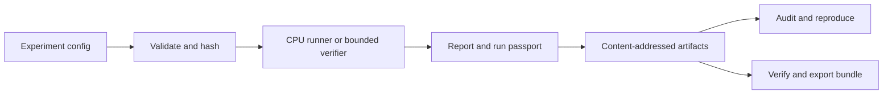

# FORGE

### Reproducible AI systems experiments

> Don't memorize AI optimizations. Measure when they work.

Forge records experiments as verifiable evidence: a declared workload, configuration digest, run passport, measured report, and linked artifacts. Its goal is to make optimization results inspectable and reproducible across NVIDIA A100 and Intel Gaudi systems.

The current `0.1.0` implementation provides a runnable CPU experiment engine, evidence auditing, checkpoint recovery, bounded verification, and paired comparison analysis. The wider cross-accelerator product is defined in the [roadmap](FORGE_V1_PLAN.md); accelerator training, kernels, distributed execution, and serving remain future work. See [implementation status](FORGE_STATUS.md) for the evidence and release gates.

## Implemented capabilities

| Component | Behavior |
| --- | --- |
| Experiment contracts | Pydantic validation, canonical JSON, and stable configuration identities |
| Evidence storage | Content-addressed artifacts, verified reads, atomic publication, SQLite run registry |
| Run auditing | Checks links between configuration, report, passport, source, and checkpoint |
| CPU training and recovery | Tiny causal transformer with optimizer/RNG checkpoints and exact same-host resume comparison |
| Bounded verifier | Short-lived worker for a restricted AST language, with separate task, timeout, tamper, and infrastructure outcomes |
| Evidence portability | Deterministic CPU bundles with safe verification and idempotent import |
| Data and analysis | Data lineage, duplicate/overlap filtering, token-layout analysis, bucket optimization, and Pareto-frontier core |
| Paired comparisons | Preregistered A100 protocol schema and preliminary paired throughput, memory, and quality analysis |



The last recorded local suite passed **77 tests on October 10, 2026**. The saved [CPU microbenchmark](benchmarks/results/data_lineage_cpu_2026-10-10.json) includes favorable and weak synthetic cases; those timings establish CPU fixture behavior only. No measured A100/Gaudi optimization claim is published.

## Try the local evidence engine

Use Python 3.10 or newer. The tested local environment is Python 3.12.

```bash
python3.12 -m venv .venv
.venv/bin/python -m pip install -c constraints/dev.txt -e '.[dev]'
.venv/bin/forge version
.venv/bin/forge hardware-probe
.venv/bin/forge experiment validate configs/l0_packing.json
.venv/bin/forge data build configs/l0_train_rows.jsonl configs/l0_eval_rows.jsonl
.venv/bin/forge run configs/l0_packing.json
.venv/bin/forge runs list
.venv/bin/forge buckets recommend configs/l0_packing.json
.venv/bin/forge verifier score configs/l0_factorial_task.json configs/l0_factorial_solution.py
.venv/bin/forge verifier compare configs/l0_comparison.json
.venv/bin/forge runs audit
.venv/bin/pytest -q
```

For the optional real CPU training smoke, install the L0 extra and run the tiny causal transformer:

```bash
.venv/bin/python -m pip install -c constraints/l0-macos-arm64.txt -e '.[l0]'
.venv/bin/forge run configs/l0_train.json
.venv/bin/forge l0 recovery-check configs/l0_train.json --split-step 5
```

The L0 constraints file is tested on macOS arm64 with Python 3.12; other hosts need a compatible PyTorch build. This tiny model does optimize a real loss and saves a full optimizer/RNG checkpoint. The recovery check compares an uninterrupted run against an interrupted and resumed run byte-for-byte. It is a correctness exercise, not a useful language model or a measured A100/Gaudi result.

On each actual accelerator host, run the matching command:

```bash
forge accelerator preflight cuda
forge accelerator preflight hpu
```

Each writes a content-addressed readiness report. It exits nonzero when the requested device is unavailable or the small FP32/BF16 numerical placement check fails; a `READY` result is **not** a training, throughput, or FP8 compatibility claim. Backend API assumptions follow the [PyTorch CUDA documentation](https://docs.pytorch.org/docs/stable/cuda.html) and [Intel Gaudi HPU API documentation](https://docs.habana.ai/en/latest/PyTorch/Reference/Python_Packages.html). Check the current [Gaudi support matrix](https://docs.habana.ai/en/latest/PyTorch/Reference/PyTorch_Support_Matrix.html) before choosing a training mode.

The first A100 centerpiece comparison has a preregistration and analysis interface:

```bash
forge benchmark preregister PATH_TO_REVIEWED_SPEC.json
forge benchmark analyze PATH_TO_EVIDENCE_INDEX.json
```

The spec freezes a 2,048-token BF16 SFT workload, model/data revisions, useful-token budget, one isolated intervention, at least three seeds and repeats, and at least 30 held-out tasks. The analyzer requires paired baseline/candidate trials on a matching A100 preflight and software lock, then computes paired throughput, peak-memory, latency, and held-out quality intervals. It labels every output `PRELIMINARY_UNAUTHENTICATED`: content-addressed reports can still be fabricated. An instrumented A100 training runner remains to be built. The repository's fixtures are synthetic public examples; downloaded models, private datasets, and hardware logs require separate rights and privacy review before publication.

After `forge run`, use the printed ID with `forge runs show RUN_ID`, `forge doctor RUN_ID`, `forge runs audit RUN_ID`, and `forge reproduce RUN_ID`. The audit checks integrity and cross-references, **not whether a scientific claim is true**. Reproduction refuses source changes, including dependency-constraint changes; use the same checkout for an exact rerun. Local artifacts and the development registry live under `.forge/` and are ignored by Git. `forge release verify` currently exits nonzero and lists missing release evidence. Both sample datasets are synthetic. The data builder proves lineage, duplicate removal, and eval leak detection on a small fixture; it is not yet the scalable final data plane. The length-layout report makes no training or hardware speed claim.

To move a local CPU run's evidence to another Forge workspace:

```bash
.venv/bin/forge bundle export RUN_ID /private/tmp/forge-run.tar.gz
.venv/bin/forge bundle verify /private/tmp/forge-run.tar.gz
.venv/bin/forge bundle import /private/tmp/forge-run.tar.gz --workspace /private/tmp/forge-clean-room
.venv/bin/forge runs audit RUN_ID --workspace /private/tmp/forge-clean-room
.venv/bin/forge reproduce RUN_ID --workspace /private/tmp/forge-clean-room
```

The bundle is deterministic, checks every content hash and cross-reference, and never extracts archive paths during verification. Its current format is limited to local CPU runs and 64 MiB per artifact. Hashes prove internal integrity, **not authorship or authenticity**. The bundle is **not encrypted** and may contain model checkpoints or source material: inspect permissions and licenses before sharing it or adding it to Git. Import proves evidence portability, not that a different machine will produce identical floating-point results.

The CPU data-lineage filter uses an exact-pair set and shared-shingle candidate index before exact Jaccard checks. Reproduce its synthetic, paired CPU microbenchmark with `python benchmarks/data_lineage_cpu.py --rows 6000 --repeats 5 --distribution disjoint`, then replace the distribution with `shared_shingle` and `duplicate_heavy`. Raw October 10 results and their limitations are in `benchmarks/results/data_lineage_cpu_2026-10-10.json`. The favorable 52.85× case is **not** a general corpus, A100, or SFT speedup; the shared-shingle case was only 1.08× at the median and one pair was slower.

The verifier's fixture tasks and held-out cases are committed examples, **not secret benchmarks**. Scoring now runs in a separate short-lived process with a wall-clock deadline and CPU/file-size limits. That worker evaluates a bounded AST language, never arbitrary submitted Python; process separation is **not a security sandbox**. The paired comparison deliberately reports `TOY_SAMPLE_ONLY` for fewer than 30 tasks; it demonstrates the evidence and statistics path without making a model-quality claim. Use the comparison's `report_ref` with `forge verifier audit REPORT_REF` to replay stored submissions and recompute the result. A containerized worker, private task corpus, and attack tests remain required for the final reward system.

## Planning authority

Read in this order:

1. [`FORGE_V1_PLAN.md`](FORGE_V1_PLAN.md) - frozen product charter and release contract
2. [`FORGE_EXECUTION_PLAN.md`](FORGE_EXECUTION_PLAN.md) - sixty feature-first implementation slices
3. [`FORGE_SCOPE_TRACEABILITY.md`](FORGE_SCOPE_TRACEABILITY.md) - all forty-six source sections mapped to evidence
4. [`FORGE_LEARNING_PATH.md`](FORGE_LEARNING_PATH.md) - student-first build/test/learn method
5. [`FORGE_GITHUB_WORKFLOW.md`](FORGE_GITHUB_WORKFLOW.md) - first-session and per-slice contribution workflow
6. [`FORGE_STATUS.md`](FORGE_STATUS.md) - the one active slice and current proof state
7. [`LEARNING_LOG_TEMPLATE.md`](LEARNING_LOG_TEMPLATE.md) - required session evidence and teach-back
8. [`FORGE_DAILY_LEARNING_AND_GITHUB.md`](FORGE_DAILY_LEARNING_AND_GITHUB.md) - 120 specific build days, commits, exercises, resources, and future reading

The frozen charter wins if documents conflict. `FORGE_STATUS.md` identifies the only active slice.

## Release path

```text
S01-S27  -> systems alpha
S28-S42  -> training alpha
S43-S56  -> feature-complete beta
S57-S60  -> clean-room proof and V1 release
```

Slices are evidence units, not promised days. The product is complete only when `forge release verify` passes every applicable traceability row and mandatory experiment.

## Development and licensing

The initial implementation and planning were AI-assisted. The learning guides retain the independent prediction, test, and explain-back exercises used to establish personal understanding; publication alone does not complete those gates.

This repository is published for inspection. An open-source license has not yet been selected; dependencies retain their respective upstream licenses. No third-party model weights, private dataset, or production run artifact is included.
